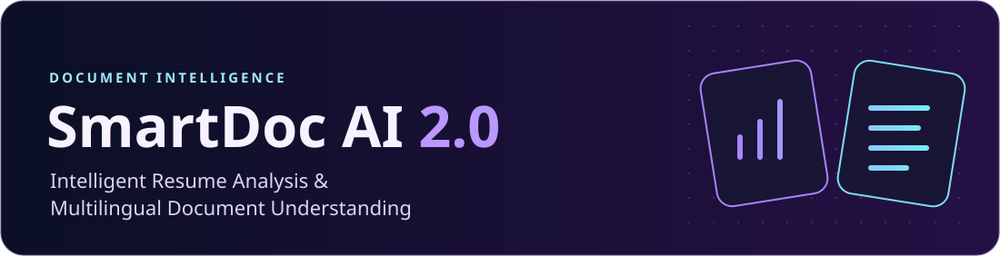
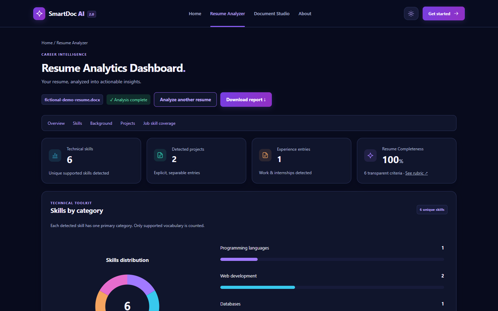
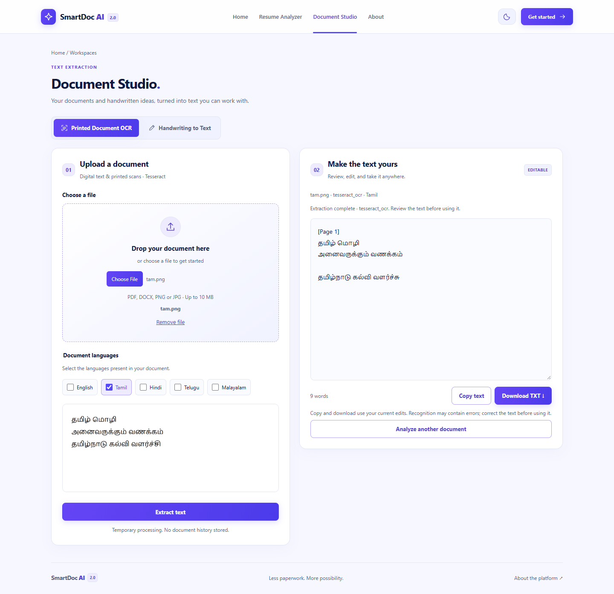
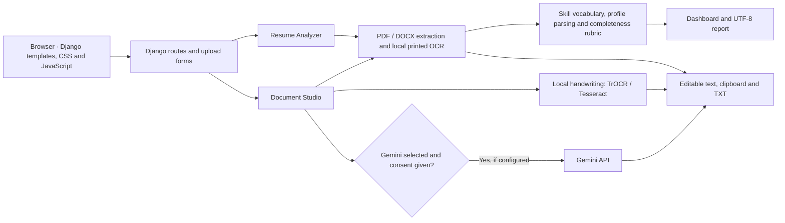

<p align="center"></p>

# SmartDoc AI 2.0


[Showcase](#application-showcase) · [Architecture](#architecture) · [Setup](#windows-setup) · [Testing](#testing) · [Privacy](#privacy-and-limitations)

SmartDoc is a Django application with two independent workspaces. Resume Analyzer turns a resume into a reviewable analytics dashboard. Document Studio extracts text from printed documents and handwriting, with tools to correct and export the result. Both workspaces share a responsive interface with Light and Midnight Purple themes; the theme choice persists in the browser.

## Application showcase

| Resume Analyzer · Midnight Purple | Document Studio · Tamil OCR |
| :---: | :---: |
| [](docs/screenshots/resume-dashboard-midnight.png) | [](docs/screenshots/tamil-printed-ocr.png) |

[Browse all seven application captures →](docs/screenshots/README.md)

## Resume Analyzer

Upload a PDF, DOCX, PNG or JPEG to extract text and identify supported technical skills, candidate details, education, experience and projects. The dashboard groups detected skills, shows a breakdown of the six completeness criteria, and offers suggestions and a downloadable UTF‑8 text report.

Analysis starts without a job description. Add one to see which supported skills detected in the description also appear in the extracted resume. Coverage is the fraction of detected job skills that matched. It is separate from completeness and does not assess proficiency or make a hiring decision.

## Document Studio

Printed mode reads digital PDF and DOCX text where available and uses local Tesseract for scanned pages and images. Choose one or more installed printed OCR languages:

| English | Tamil | Hindi | Telugu | Malayalam |
| --- | --- | --- | --- | --- |
| `eng` | `tam` | `hin` | `tel` | `mal` |

Handwriting mode accepts PDF and images. It offers local English TrOCR, a local Tesseract alternative and an English comparison that lets the user choose between the two outputs. The TrOCR pipeline segments lines and can reconstruct some table-like layouts as tab-separated rows. Gemini can attempt multilingual handwriting and table transcription when configured, after explicit consent. These are text outputs; check row boundaries and cell contents against the document. Both modes support editing, copying and TXT export.

## Architecture



| Layer | Implementation |
| --- | --- |
| Web | Django, server-rendered HTML, CSS and browser JavaScript; SVG skill charts in Resume Analyzer |
| Resume processing | PDFium via pypdfium2, python-docx, Pillow, rule-based profile extraction and skill vocabulary matching |
| OCR | Tesseract via pytesseract; optional PyTorch and Hugging Face Transformers for TrOCR; optional Google Gen AI SDK for Gemini |
| Separate authenticated tools | SQLite, Django auth, recruitment records, Excel export via openpyxl and Chart.js in the legacy UI |

## Windows setup

Use Python 3.14 for the verified configuration and PowerShell. From the repository root:

```powershell
py -3.14 -m venv .venv
.\.venv\Scripts\Activate.ps1
python -m pip install --upgrade pip
python -m pip install -r requirements.txt
python manage.py migrate
.\start.ps1
```

Open [http://127.0.0.1:8000/](http://127.0.0.1:8000/). The launcher binds to loopback on port 8000; restart after configuration changes. If PowerShell blocks activation, prepend the virtual environment's Scripts directory to PATH for the current shell. This is a local development setup.

1. **Printed OCR:** Install the [Tesseract engine](https://tesseract-ocr.github.io/tessdoc/Installation.html) separately. Install the desired [language data](https://github.com/tesseract-ocr/tessdata_fast) and `osd` for orientation detection. Run `tesseract --list-langs`. Set `TESSERACT_CMD` and `TESSDATA_PREFIX` if the executable or data is in a nonstandard location.
2. **Local handwriting (optional):** Install a matching [PyTorch build](https://pytorch.org/get-started/locally/) and run `python -m pip install -r requirements-handwriting.txt`. Use the Hugging Face CLI to download `microsoft/trocr-base-handwritten` into a local directory, then set `SMARTDOC_HANDWRITING_MODEL_PATH` to that directory. The web workflow loads a local checkpoint; it does not fetch TrOCR weights on upload.
3. **Gemini handwriting (optional):** Copy `.env.example` to `.env`, set your own `GEMINI_API_KEY`, and run `python manage.py verify_gemini` to check model access. Set `GEMINI_MODEL` to a verified ID and restart. Verification contacts Google. You can leave both values empty for local processing.
4. **Authenticated recruitment tools (optional):** Create a user with `python manage.py createsuperuser` and visit `/login/`. The baseline matcher works without an embedding model. To enable local semantic ranking, install `requirements-semantic.txt` and point `SMARTDOC_SEMANTIC_MODEL_PATH` at a local copy of `sentence-transformers/all-MiniLM-L6-v2`. These tools are separate from the public resume workflow.

## Testing

Install the test dependencies with `python -m pip install -r requirements-test.txt`. Node.js runs the JavaScript checks.

```powershell
python -m pip check
python manage.py check
python manage.py test
node tools/test_theme_js.cjs
node tools/test_studio_js.cjs
node tools/test_chart_theme_js.cjs
```

Staging verification on Windows and Python 3.14: **238 passed, 0 failed, 1 skipped** (the real semantic model test); all three JavaScript checks passed. A local smoke test exercised the launcher, resume and job coverage, printed English and Tamil OCR, and OCR on a two-page scanned PDF. The suite includes document parsing, workspace behavior, simulated OCR responses, consent checks, theme behavior and resume scoring. Some checks require local Tesseract. The real semantic model test requires a configured local checkpoint. Passing mocked tests does not establish recognition accuracy or confirm live Gemini access.

## Privacy and limitations

- The two main workspaces process uploads in temporary directories and do not create recruitment records. The Resume Analyzer sends extracted text back to the browser in a signed, readable token valid for reanalysis for up to one hour. The token is not encrypted. Reports and exports stay wherever the user saves them.
- Gemini receives the document or rendered pages only when selected, configured and explicitly consented to. Its handling is governed by the provider's terms. The authenticated recruitment tools separately persist uploads and records in local media and SQLite. Their legacy pages reference external CDN assets.
- Handwriting quality, scan resolution, script mixing, missing language packs and page layout affect OCR. Table transcription can miss merged cells or reorder text. TrOCR needs a local model download and can be slow on CPU.
- Skill extraction covers a finite vocabulary. Completeness and coverage reflect extracted text; review outputs before relying on them.

## Roadmap

Improve extraction for mixed scripts and complex tables, expand the synthetic regression fixtures, and add more reproducible comparisons across OCR engines and scan conditions.

## Developer

**Kaushik Ram P** · [P-Kaushik-Ram on GitHub](https://github.com/P-Kaushik-Ram)

Copyright © 2026 Kaushik Ram P. All rights reserved. The notice applies to original SmartDoc material. See [third-party notices](THIRD_PARTY_NOTICES.md) for upstream terms.
