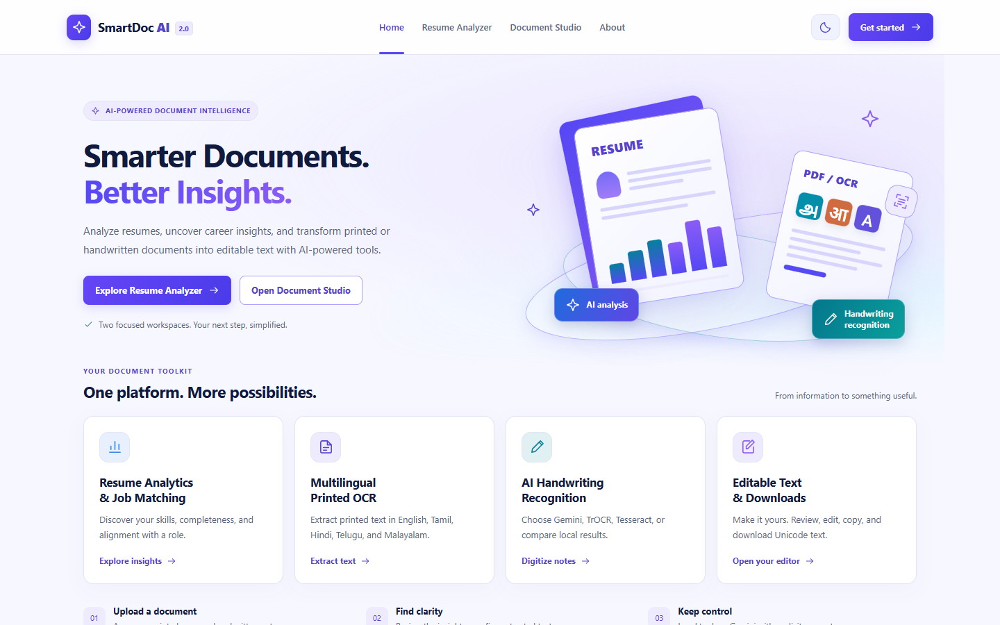
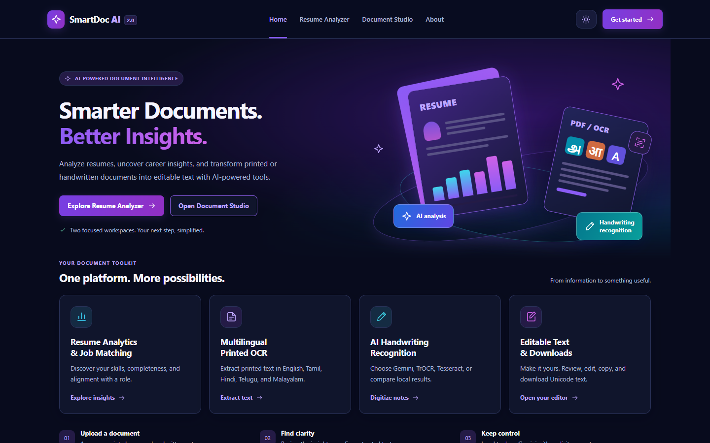
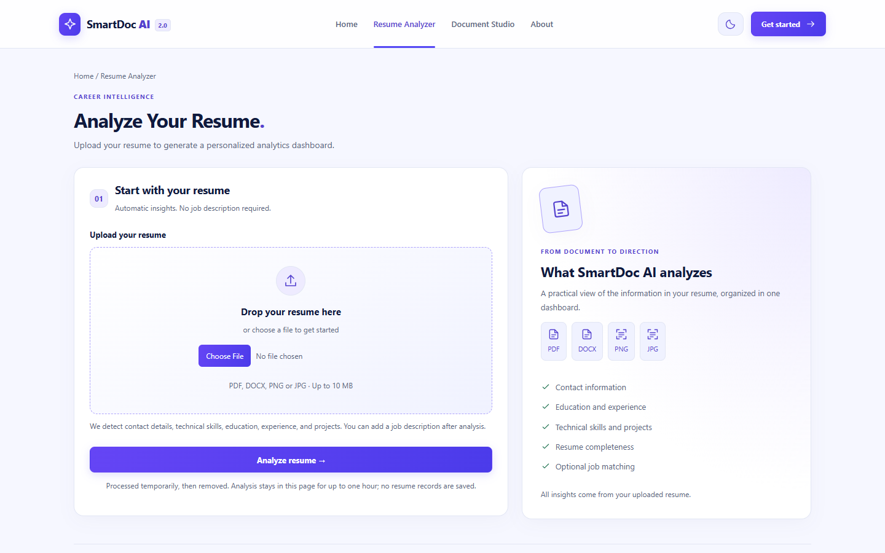
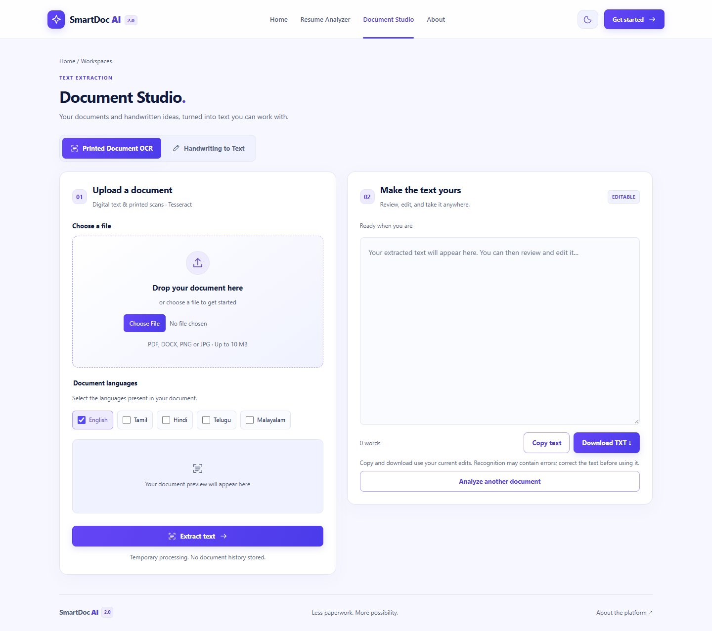
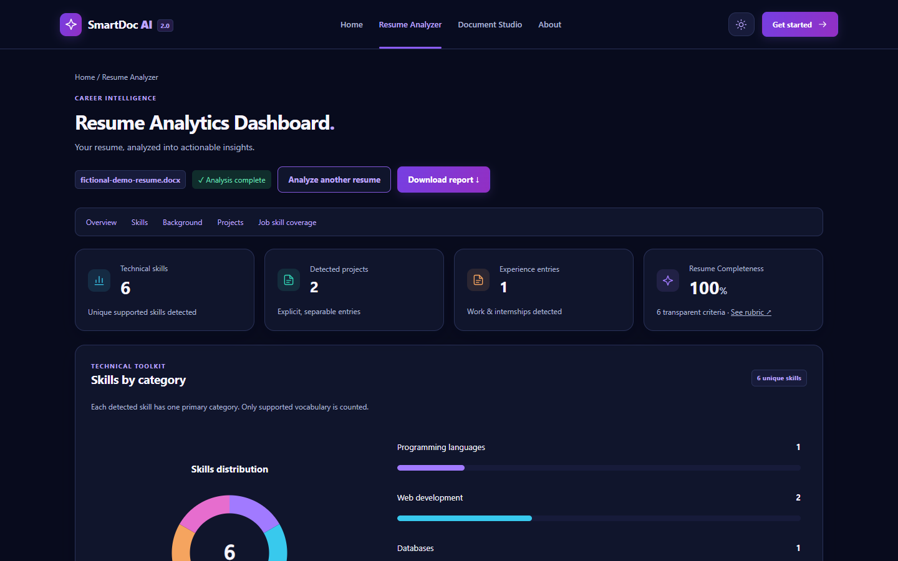
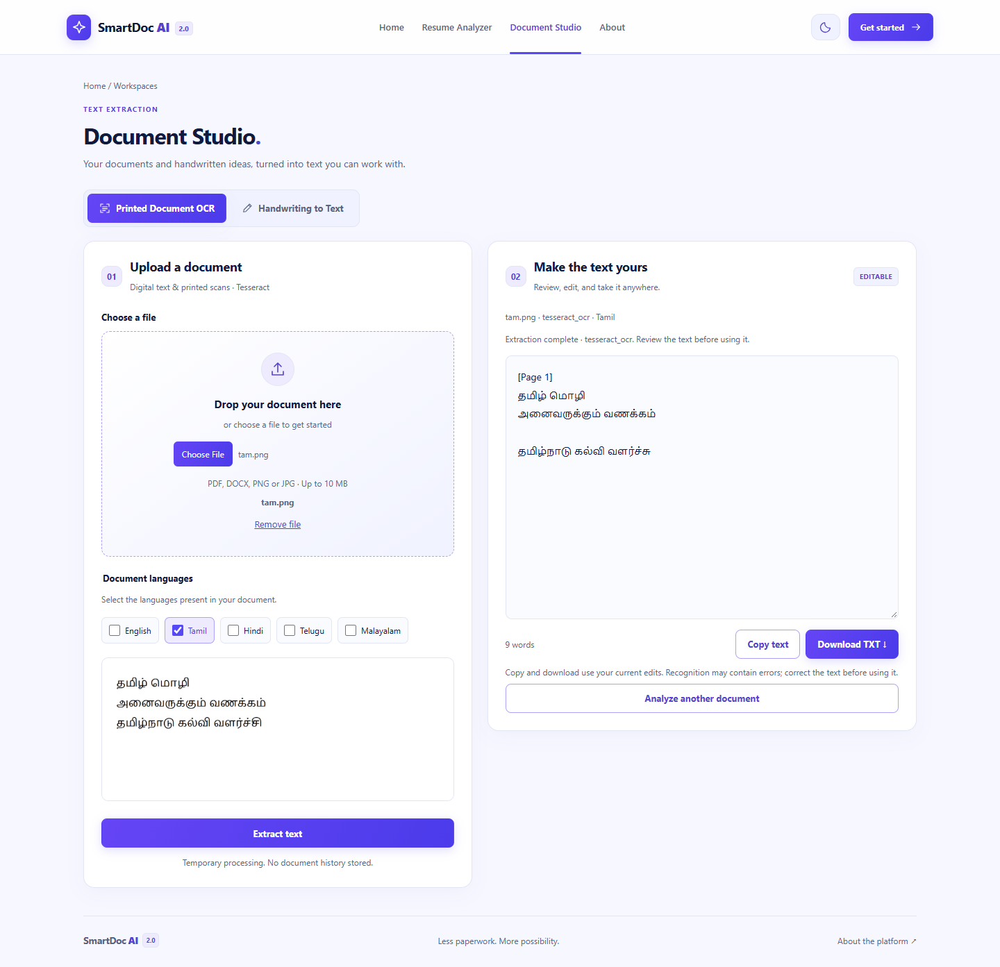
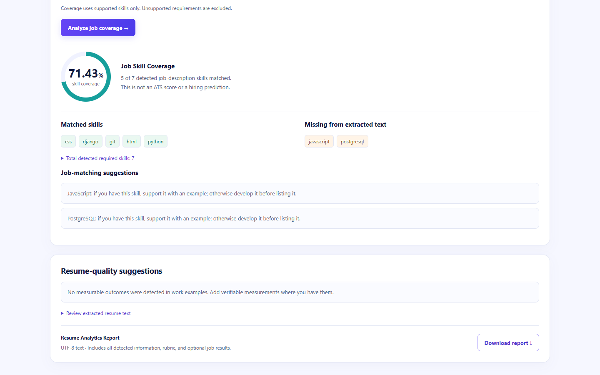

# Application screenshot gallery

[Back to SmartDoc AI 2.0](../../README.md)

These captures show the running application. The resume and job coverage views use a fictional demo; the Tamil sample is synthetic. Click a capture to view it at full resolution.

| Light | Midnight Purple |
| :---: | :---: |
|  |  |

| Resume Analyzer | Document Studio |
| :---: | :---: |
|  |  |
|  |  |

### Job description coverage

